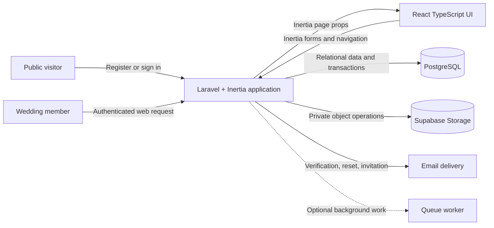

# Wedding Planner Architecture

## Purpose

This document defines the review-ready high-level technical architecture for the multi-user Wedding Planner V1 and its path toward a future commercial SaaS.

## Status

Review-ready V1 baseline. Product-owner approval is the remaining gate before M0 implementation begins.

## Table of Contents

1. [Architecture Goals](#architecture-goals)
2. [System Context](#system-context)
3. [Technology Stack](#technology-stack)
4. [Architectural Style](#architectural-style)
5. [Application Layers](#application-layers)
6. [Domain Modules](#domain-modules)
7. [Wedding Workspace Isolation](#wedding-workspace-isolation)
8. [Authentication](#authentication)
9. [Membership and Authorization](#membership-and-authorization)
10. [Authorization Matrix](#authorization-matrix)
11. [Request and Data Flow](#request-and-data-flow)
12. [Route and Screen Map](#route-and-screen-map)
13. [Financial Architecture](#financial-architecture)
14. [Customization Architecture](#customization-architecture)
15. [Template and Onboarding Architecture](#template-and-onboarding-architecture)
16. [Private File Architecture](#private-file-architecture)
17. [Search, Filtering, Pagination, and Export](#search-filtering-pagination-and-export)
18. [Transactions and Data Integrity](#transactions-and-data-integrity)
19. [Error Handling and Reliability](#error-handling-and-reliability)
20. [Security Boundaries](#security-boundaries)
21. [Performance and Scalability](#performance-and-scalability)
22. [Observability and Audit](#observability-and-audit)
23. [Deployment Considerations](#deployment-considerations)
24. [Testing Architecture](#testing-architecture)
25. [Risks and Decisions](#risks-and-decisions)
26. [Related Documents](#related-documents)

## Architecture Goals

The architecture must deliver a secure, maintainable, wedding-scoped V1 without introducing premature distributed systems or billing concerns.

## System Context

Wedding Planner is a responsive web application for couples and invited collaborators to coordinate planning data that would otherwise be spread across spreadsheets, chat, notes, and private documents. Public registration supports many independent accounts, and each user may create or join multiple wedding workspaces without needing another account.

A wedding workspace is the primary security, ownership, and reporting boundary. Its owner, editors, and viewers access the same Laravel application, but every page, query, aggregate, mutation, export, and file operation is authorized against membership in the selected wedding. Knowing another wedding's identifier or a nested record URL never grants access.

The browser communicates only with Laravel through server-driven Inertia requests. Laravel authenticates the user, authorizes the wedding context, validates input, executes domain operations, and reads or writes PostgreSQL. Private documents and payment proofs are stored as objects in Supabase Storage, but Laravel remains the authorization gateway and is the only component allowed to use storage secrets or issue short-lived signed URLs.

External email delivery supports account verification, password recovery, and wedding invitations. Optional queue workers may process invitation mail and large exports when asynchronous execution is justified, while PostgreSQL remains the source of truth for operation state.



## Product Boundaries

### Included in V1

V1 includes public registration and Laravel authentication, account profiles, multiple wedding workspaces per user, membership and invitations, owner/editor/viewer roles, onboarding and independent template cloning, dashboard and countdown, events, tasks and Gantt views, budget scenarios, wedding budgets with repeatable payment terms, savings, seserahan, administration checklists, private vendor contact records, guests, rundown, playlist, private attachments, configurable references, limited custom fields, search, filtering, sorting, pagination, and selected exports.

Vendor information in V1 is private data manually entered by a wedding member. It supports internal contact and planning needs and does not represent a vendor-owned profile, account, listing, or marketplace presence.

Custom fields are limited to guests first, followed by tasks, checklist items, and budget items. Core financial, ownership, authorization, relational, and important date fields remain typed schema fields and cannot be replaced by custom fields.

### Excluded from V1

V1 excludes subscription plans, billing, payment gateway integration, usage-based entitlements, SaaS invoicing, paid trials, vendor registration, vendor authentication, public vendor listings, vendor-facing features, vendor custom fields, vendor marketplace transactions, Wedding Organizer multi-client administration, white-label support, public invitation websites, QR check-in, automatic guest-facing RSVP, native mobile applications, and generic no-code form or workflow builders.

Future commercial features may extend the identity and wedding-membership foundation, but they must not be anticipated through speculative V1 tables, services, routes, or user interfaces.

### System Boundaries

- Laravel Auth is the only identity provider; Supabase Auth is not used.
- React never connects directly to PostgreSQL or uses Supabase service credentials.
- PostgreSQL stores authoritative application and file-metadata records; Supabase Storage stores private file objects only.
- Laravel computes permissions and financial totals on the server and never trusts browser-supplied roles, wedding identifiers, prices, totals, or balances.
- The application is one Laravel and Inertia deployment, not a separate REST API and frontend repository.
- Integrations are introduced only when required by an approved milestone and accessed through a server-side boundary.

## Technology Stack

| Area | Technology | Architectural responsibility |
|---|---|---|
| Backend and application | Laravel 13 on PHP 8.3 or newer | Routing, session authentication, authorization, validation, domain operations, transactions, exports, file authorization, and Inertia responses |
| Frontend | React 19 with TypeScript | Typed pages and components, Inertia forms, accessible interactions, responsive layouts, and presentation-only calculations |
| Server-driven navigation | Inertia 3 | Connects Laravel routes and controllers to React pages without creating a separate public application API |
| Styling | Tailwind CSS 4 and the official starter's shadcn/ui baseline | Consistent, accessible, warm, modern, and information-dense interface styling |
| Database | PostgreSQL | Authoritative relational data, constraints, transactions, controlled JSONB, indexes, and wedding-scoped aggregates |
| Authentication | Laravel authentication | Registration, login, logout, password reset, email verification, and session management |
| File storage | Private Supabase Storage bucket through Laravel | Private file objects accessed only after Laravel authorization through short-lived signed URLs |
| Backend testing | PHPUnit with Laravel feature and unit tests | Route, middleware, Policy, validation, transaction, domain calculation, and workspace-isolation coverage |
| Frontend testing | Vitest and React Testing Library when focused behavior coverage is warranted | Focused coverage for complex forms, filters, file states, custom fields, and read-only role behavior |
| End-to-end testing | Playwright after critical flows stabilize | Browser verification of registration, workspace creation, planning, finance, invitation, and isolation journeys |
| Background work | Laravel queue when required | Invitation email and bounded asynchronous exports without introducing another application service |

M0 uses the official Laravel 13 React starter with Inertia 3, React 19, Tailwind CSS 4, and its shadcn/ui baseline. PHP 8.3 is the minimum runtime, PHPUnit is the backend test runner, local development and automated tests use separate PostgreSQL databases, local queues run synchronously, deployed sessions use the database driver, and the deployment baseline is a container-compatible Linux VPS. Exact patch versions and package scripts are pinned by the generated lock files; email and observability providers remain deferred until required. Major dependencies require approval rather than being introduced solely because they are common in example projects.

## Architectural Style

The application uses a wedding-scoped modular monolith with explicit domain boundaries and server-driven Inertia navigation.

## Application Layers

HTTP coordination, authorization, validation, business operations, persistence, presentation, and external storage are separated into focused responsibilities.

## Domain Modules

The application is divided into identity, workspace, setup, planning, finance, savings, checklists, private vendor contacts, guests, event-day, files, customization, export, and audit modules.

## Wedding Workspace Isolation

A wedding workspace is the primary tenant and data-security boundary. A user may own or join multiple weddings, but access to one workspace never implies access to another. Every workspace request must resolve one active wedding and verify the authenticated user's current membership before reading page data or executing an operation.

Every operational record, configurable reference, repeatable child record, attachment, export, and activity log carries `wedding_id` directly. Direct tenancy keys make authorization reviews, aggregate queries, indexes, exports, file reconciliation, and incident investigation explicit even when a record could otherwise inherit its wedding through a parent.

Workspace isolation uses defense in depth:

1. Public wedding routes use an immutable UUID rather than a sequential database identifier.
2. Authentication middleware rejects unauthenticated access to workspace routes.
3. Wedding-membership middleware verifies that the user belongs to the route wedding.
4. Nested route model binding is scoped to the resolved wedding.
5. A Policy authorizes the requested action for the member's role.
6. Queries begin from the active wedding or include an explicit `wedding_id` constraint.
7. Form Requests verify that submitted related records belong to the same wedding.
8. Composite database constraints protect tenant-sensitive parent-child relationships where practical.
9. Wedding-specific uniqueness constraints include `wedding_id`.
10. Feature tests attempt cross-wedding reads, mutations, relationship assignment, aggregates, exports, and file access.

Route model binding and membership middleware provide early rejection but do not replace Policies. Policies determine whether an authenticated member may perform the requested capability, while scoped queries and database constraints prevent records from crossing tenant boundaries accidentally.

The preferred lookup direction is:

```text
active wedding
  -> authorized wedding relationship
  -> filtered module query
  -> requested record
```

The application must not retrieve an operational record globally from a browser-provided identifier and only afterward compare its wedding. Related identifiers such as event, category, status, vendor, assignee, guest group, payment term, attachment, and custom-field definition are validated against the active wedding before persistence.

Response behavior avoids unnecessary disclosure: a member who lacks permission for an operation receives `403 Forbidden`, a nested record outside the route wedding resolves as `404 Not Found`, and a user without membership in the requested wedding receives `403 Forbidden` as required by the PRD. Dashboard aggregates and exports are rebuilt from wedding-scoped server queries and never from browser-supplied totals or unrestricted record lists.

## Authentication

Laravel authentication is the application's only identity system. Authentication is session-based and uses Laravel's web middleware, password hashing, CSRF protection, signed verification routes, password-reset tokens, and rate limits for sensitive endpoints. Supabase Auth is not used, and storage credentials never participate in browser authentication.

Public account flows include registration, login, forgot password, reset password, and email verification. Registration accepts many users without a hardcoded allowlist and requires a name, a case-insensitively unique email address, a password, and password confirmation. Password-reset tokens are single-use and expire according to the approved Laravel configuration.

Authenticated users may update their name, optional avatar, email address, and password. Changing an email address marks the account unverified and requires verification of the new address. Session duration and invalidation follow the selected Laravel authentication starter and security configuration established during M0.

Email verification is required before a user may send wedding invitations or upload private files. An unverified user may still create and explore their own wedding workspace so onboarding does not block before product value is visible. Verification-gated endpoints enforce the rule on the backend even when the React interface disables or hides the corresponding controls.

Authentication establishes who the user is; it does not prove access to a wedding or permission to act on its data. Every protected workspace request continues through membership resolution and Policy authorization after session authentication succeeds.

## Membership and Authorization

`wedding_members` relates users to weddings and assigns one fixed V1 role: `owner`, `editor`, or `viewer`. The `(wedding_id, user_id)` pair is unique, and each active wedding has exactly one owner. Creating a wedding and its owner membership occurs in one transaction.

The owner administers workspace identity, settings, membership, invitations, ownership transfer, and workspace deletion in addition to managing operational data. Editors manage operational planning records but cannot manage membership, transfer ownership, or perform owner-only workspace actions. Viewers have read-only access and cannot mutate or export workspace data in V1.

Authorization is enforced through Laravel Policies or an equivalent approved server-side layer for every protected read, mutation, export, and file operation. UI visibility reflects permissions for usability, but hidden or disabled controls are never treated as a security boundary. Form Requests may call the relevant Policy during request authorization, while controllers remain responsible for coordinating the already-authorized HTTP operation.

Invitation rules are separate from ordinary role updates:

- Only a verified owner may invite an email address as `editor` or `viewer`.
- Invitation tokens are random, stored hashed, single-use, and time-limited.
- A user may accept or decline only an invitation addressed to their verified normalized email.
- Only the source wedding's owner may cancel a pending invitation.
- Acceptance fails safely when the invitation is expired, cancelled, declined, already accepted, or points to a deleted wedding.
- Invitations cannot grant ownership or create a second owner.

Ownership transfer is an explicit owner-only operation to an existing active member. The transfer locks the relevant wedding and membership records, promotes the target to owner, and demotes the previous owner to editor in one transaction. The owner cannot leave or be removed until ownership has been transferred. A database constraint enforces at most one owner, while transactional application rules ensure an active wedding never has zero owners.

Assignees and responsible members reference an active membership in the same wedding rather than an arbitrary user account. Queue jobs and exports re-establish their wedding context from durable identifiers and authorization rules rather than depending on an HTTP session captured earlier.

## PostgreSQL Responsibilities

PostgreSQL is the authoritative source of truth for identity-linked application data, wedding ownership, membership, configuration, operational records, financial values, file metadata, and audit history. Supabase Storage stores file bytes only; React state, formatted values, cached aggregates, and signed URLs are never authoritative records.

The relational schema enforces the wedding boundary through direct `wedding_id` columns on operational and repeatable child records. Tenant-sensitive relationships use composite integrity where practical so a child record cannot reference a parent from another wedding. Wedding-specific uniqueness includes `wedding_id`, including membership, configurable keys, category names or slugs where required, status keys, guest labels, and custom-field keys.

PostgreSQL is responsible for:

- Persisting users, weddings, memberships, invitations, events, templates, and independent cloned template data.
- Persisting every planning, finance, savings, checklist, private vendor-contact, guest, rundown, playlist, attachment, custom-field, and activity-log record.
- Enforcing foreign keys, uniqueness, non-negative amounts and counts, valid date ranges where expressible, and tenant-consistent parent-child relationships.
- Providing transactions and row locks for workspace creation, ownership transfer, template cloning, scenario application, financial mutations, and ordered-record updates.
- Supporting deterministic server-side search, filtering, sorting, pagination, aggregates, and exports.
- Retaining file metadata and lifecycle state independently from the private object store.
- Recording actor and timestamp evidence for sensitive financial, membership, ownership, and file operations.

Indonesian Rupiah values use signed `BIGINT` columns representing whole rupiah. Floating-point and formatted currency strings are prohibited. Estimated amounts, final committed amounts, planned payment amounts, actual paid amounts, and savings contributions remain separate fields or records so each aggregate has one defined source.

Calendar-only planning values use PostgreSQL `date`. Actual instants are stored in UTC timestamps and rendered in the wedding timezone. Rundown times remain associated with a wedding event and are interpreted in that workspace's timezone. Editable labels are separated from immutable behavioral flags so renaming a status such as `Selesai` does not change completion calculations.

Controlled JSONB is limited to data whose structure is genuinely variable, such as template payloads, custom-field options, validated custom-field values, and structured audit changes. JSONB does not replace core financial fields, authorization attributes, relational keys, indexed dates, or module records.

Indexes are designed around verified wedding-scoped query patterns, normally beginning with `wedding_id` and followed by selective filter or ordering columns. List queries use a deterministic unique tie-breaker for stable pagination. Indexes are confirmed with representative data and PostgreSQL query plans rather than added mechanically to every filtered column.

## Inertia and React Architecture

Inertia.js connects Laravel routes and controllers to React pages without creating a separate frontend application or public REST API. Laravel owns routing, authentication, authorization, validation, persistence, and authoritative calculations; React owns typed presentation, user interaction, local form state, and accessible feedback.

GET requests return explicit, serializable page props containing only data needed by the current screen. Sensitive fields, storage keys, secrets, unrestricted model serialization, and unrelated wedding data are excluded. Shared props are limited to stable cross-page context such as the authenticated user, accessible wedding summaries for the switcher, active membership role, flash messages, and validation state.

Mutations use Inertia form conventions against Laravel web routes protected by CSRF middleware. The browser submits user-entered fields and related public identifiers, while Laravel independently resolves the active wedding, authorizes the action, validates tenant ownership of referenced records, computes server-owned values, and redirects with an appropriate success or error message. React may display provisional totals for responsiveness but must replace them with server-authoritative results after the response.

Frontend code uses TypeScript with explicit page-prop, form, filter, pagination, and domain-display types. `any` is not used to bypass domain modeling unless a narrow documented exception is approved. Server enums and configurable references are delivered as controlled options rather than duplicated as uncoordinated frontend constants.

Page organization follows product workflows rather than generic schema rendering. Representative page groups include authentication, onboarding, app shell, dashboard, timeline and Gantt, budget and payment terms, savings, seserahan, administration, private vendor contacts, guests, rundown, playlist, files, members, and settings. Reusable primitives are extracted only after a meaningful repeated interaction exists.

Meaningful list state is represented in URL query parameters, including search, filters, sorting, page number, and relevant view mode. Laravel validates sort fields against an allowlist and reconstructs every query from the active wedding. Inertia navigation preserves shareable filter state inside the authorized workspace but does not make a protected URL accessible to non-members.

Every significant page includes applicable loading, empty, validation-error, operation-error, success, disabled, read-only, and destructive-confirmation states. Viewer screens render an explicitly read-only experience rather than relying only on hidden buttons. Keyboard navigation, visible focus, semantic labels, and text or icon support ensure status is not conveyed by color alone.

Dense planning tables and timeline views are desktop-first, while important create, edit, detail, and completion flows remain usable on mobile. Wide tables and diagrams scroll within their own containers, and financial detail remains readable rather than being hidden behind decorative cards or modal-only interactions.

## Supabase Storage Flow

Supabase Storage provides a private object bucket for documents, contracts, invoices, payment proofs, scans, images, and supported custom-field file references. PostgreSQL stores attachment metadata and lifecycle state, while Laravel is the only component permitted to use storage credentials or request signed object access.

The V1 upload allowlist is PDF, JPG/JPEG, PNG, and WebP with a maximum size of 10 MB per file. Laravel validates the declared extension, detected MIME type, file size, filename safety, target module, target-record authorization, and wedding ownership before accepting an upload. The original filename is retained only as display metadata and is never used as the object key.

Upload follows this flow:

1. A verified owner or editor submits a file to a wedding-scoped Laravel route.
2. Membership middleware and the target record's Policy authorize the operation.
3. A Form Request validates the file and confirms that its linked subject belongs to the active wedding.
4. Laravel generates an immutable file UUID and a storage path such as `weddings/{wedding_uuid}/{module}/{file_uuid}.{ext}`.
5. An attachment record enters a controlled pending state when lifecycle tracking is needed.
6. Laravel uploads the object to the private bucket through a server-side storage adapter.
7. After successful storage, PostgreSQL records the safe MIME type, extension, byte size, original display name, uploader, purpose, object key, optional checksum, and `available` state.
8. If storage or database persistence fails, the operation performs safe compensating cleanup or leaves an observable reconciliation state rather than active false metadata.

Preview and download follow a separate authorization path for every request. Laravel verifies current membership, the attachment's `wedding_id`, its linked subject and module, lifecycle state, and the user's permission to view that subject. Only then does Laravel return or redirect to a short-lived signed URL. Signed URLs are not stored as durable data, included in long-lived shared Inertia props, written to logs, or treated as proof of future authorization.

Deletion cannot be made atomic across PostgreSQL and Supabase Storage, so it uses an explicit lifecycle. An authorized owner or editor marks the attachment for deletion, Laravel attempts object removal idempotently, and metadata is finalized only when the outcome is known. A failed storage deletion remains visible for retry or reconciliation and never silently removes the database reference while leaving an unmanaged private object.

Storage access is wrapped behind an application contract so domain Actions do not depend directly on Supabase-specific APIs. Most feature tests use a fake implementation, while focused adapter integration tests verify upload, signed-URL, deletion, error mapping, and path behavior against a non-production bucket. The browser never receives the service-role key, database credentials, or permanent public object URL.

## Authorization Matrix

| Capability | Owner | Editor | Viewer |
|---|---:|---:|---:|
| Read operational data and private attachments | Yes | Yes | Yes |
| Mutate operational records | Yes | Yes | No |
| Upload or delete authorized attachments | Yes | Yes | No |
| Export wedding data | Yes | Yes | No |
| Manage invitations, members, or roles | Yes | No | No |
| Transfer ownership or delete the wedding | Yes | No | No |

Policies enforce this matrix per resource. Crafted requests cannot elevate an editor into workspace administration or turn a viewer into a writer.

## Request and Data Flow

Laravel authenticates the user, resolves the route wedding, verifies active membership, scopes nested bindings, authorizes the capability, validates input and same-wedding relationships, and invokes a focused Action. The Action persists through Eloquent, using a transaction where required, and returns explicit Inertia props or a Post/Redirect/Get response.

React never submits authoritative totals, roles, storage paths, or lifecycle state. Queue jobs receive durable identifiers and re-resolve wedding context instead of depending on a captured browser session.

## Route and Screen Map

| Route group | Representative screens | Boundary |
|---|---|---|
| Public/auth | Landing, register, login, reset, verification | Guest or account middleware |
| Account | Profile, invitations, wedding index | Authenticated user |
| Onboarding | Create wedding, select template, accept invitation | Authenticated user |
| `/weddings/{wedding}` | Dashboard and switcher | Active membership |
| `/weddings/{wedding}/{module}` | Planning, finance, logistics, event-day, files | Membership plus resource Policy |
| `/weddings/{wedding}/settings` | Wedding, members, invitations, customization | Owner for admin mutations |

## Financial Architecture

Budget scenarios remain exploratory and are copied atomically into independent committed records. Estimates and final commitments are distinct `BIGINT` whole-rupiah values. Each budget item has ordered payment-term children; fixed DP or numbered-termin columns are prohibited.

Paid totals sum only records accepted by the valid-paid rule. Outstanding equals final commitment minus valid paid amounts; overpayment warns without rewriting the commitment. Savings remain separate from vendor expenditure, and sensitive financial mutations create audit evidence.

## Customization Architecture

Customization uses typed core columns, wedding-scoped reference tables, repeatable child rows, and definition/value tables for optional custom fields. Custom fields launch for guests first, followed by tasks, checklist items, and budget items; vendor custom fields are outside V1.

Definitions declare supported type, key, label, required state, options, order, and active state. Values are validated server-side. Custom fields cannot control authorization, ownership, core relationships, indexed dates, or authoritative financial aggregates.

## Template and Onboarding Architecture

Templates are application-owned masters. Wedding setup clones the selected template into independent wedding-owned events, references, tasks, scenarios, checklists, rundown items, and playlist items in one transaction. Failure rolls back the setup slice.

Relative dates use an approved anchor event. The exact anchor remains a decision required before M2 and does not block M0 or M1.

## Private File Architecture

The detailed lifecycle is defined in Supabase Storage Flow. Domain modules reference PostgreSQL attachments, never raw object keys. A replaceable storage adapter uses fakes for feature tests and focused integration tests against a non-production private bucket.

## Search, Filtering, Pagination, and Export

List state uses validated URL query parameters, allowlisted sorts, wedding-scoped server queries, deterministic tie-breakers, and bounded pagination. Exports reuse the same scoped queries and filters; they never accept a browser-provided dataset.

Owner and editor may export; viewer may not. Excel is first for budget, guests, tasks/timeline, checklists, and rundown. PDF follows for print-oriented output after core CRUD and Excel stabilize.

## Transactions and Data Integrity

Transactions protect wedding creation, ownership transfer, template cloning, scenario application, financial updates, and ordered-list mutations. Row locks and composite same-wedding constraints protect concurrent and tenant-sensitive invariants. Storage and PostgreSQL cannot share a transaction, so file flows use explicit lifecycle states and idempotent reconciliation.

## Error Handling and Reliability

Validation and authorization failures return stable messages without stack traces or sensitive identifiers. Inertia preserves safe form state and field errors. Concurrent conflicts provide a refresh or retry path rather than silently overwriting protected state.

Queue work is idempotent with bounded retries. External email and storage errors map to domain outcomes, while partial file operations remain observable and retryable. Logs exclude tokens, signed URLs, secrets, and private content.

## Security Boundaries

- Laravel session authentication, CSRF protection, secure cookies, password hashing, and rate limits protect account entry points.
- Every wedding-scoped request verifies authentication, active membership, role permission, and record ownership on the server.
- Policies authorize protected reads, mutations, exports, and file access; hidden or disabled React controls are never security controls.
- Queries, aggregates, searches, exports, route bindings, and related-record validation remain explicitly scoped to the active `wedding_id`.
- Browser-supplied wedding IDs, roles, permissions, prices, totals, balances, lifecycle states, and storage paths are untrusted input.
- React receives only necessary serialized page props and never receives database credentials, Supabase service credentials, internal object keys, or unrestricted models.
- Private files require verified-email upload access, backend extension/MIME/size validation, generated object keys, Policy checks, and short-lived signed URLs.
- Financial calculations and sensitive multi-record changes execute server-side using validation, transactions, database constraints, and actor-attributed audit records.
- Invitation and password-reset tokens are random, stored safely, single-use, time-limited, rate-limited, and excluded from application logs.
- Production secrets remain outside source control, logs redact sensitive context, errors avoid internal details, and security-sensitive dependencies receive timely supported updates.

## Performance and Scalability

The modular monolith scales vertically for early access and may add stateless web workers without changing domain boundaries. Wedding-first indexes, eager loading, aggregate subqueries, and server pagination prevent obvious N+1 and unbounded responses. Dashboard queries are measured with representative data before caching.

Large exports and email may move to queues after thresholds are measured. Any cache key includes wedding and permission-sensitive context, and invalidation follows authoritative writes.

## Observability and Audit

Structured logs distinguish web, database, queue, email, and storage failures and carry correlation identifiers. Error reporting redacts secrets, tokens, signed URLs, passwords, and private content. Health monitoring detects dependency failure without exposing wedding data.

Wedding-scoped activity records capture actor, action, subject, timestamp, and controlled change evidence for ownership, membership, important finance, and file lifecycle operations.

## Deployment Considerations

- V1 deploys as one Laravel and Inertia application rather than separate backend and frontend services.
- The runtime requires a supported PHP environment, Node-built frontend assets, PostgreSQL, and HTTPS at every public endpoint.
- Production configuration and secrets are injected outside source control, with separate credentials and resources for development, testing, staging, and production.
- PostgreSQL migrations run through a controlled release step with backups, rollback assessment, and compatibility across rolling application updates.
- A private Supabase Storage bucket is provisioned per environment with least-privilege server credentials and no public object access.
- A Laravel queue worker is deployed only when approved asynchronous work exists, with bounded retries, idempotent jobs, failed-job visibility, and wedding context restored from durable identifiers.
- Scheduled commands are run by a single coordinated scheduler for cleanup, invitation expiry, storage reconciliation, and other approved maintenance tasks.
- Health checks cover the web runtime and essential dependencies without exposing secrets, internal paths, or private wedding data.
- Centralized logs, error reporting, audit events, uptime monitoring, and alerting distinguish application, database, queue, email, and storage failures.
- Releases include dependency installation, frontend build, configuration caching, migration, worker restart, smoke checks, and a documented recovery procedure; the exact hosting platform is selected during M0.

## Testing Architecture

Laravel feature tests cover auth, middleware, Policies, validation, scoped bindings, transactions, exports, and storage authorization. Unit tests cover financial calculations, date offsets, ordering, and pure domain rules. Tenant-sensitive modules include three-wedding isolation cases for reads, writes, relationships, aggregates, exports, and files.

React tests focus on complex forms, filters, validation rendering, custom fields, uploads, reordering, and viewer read-only behavior. Storage contract and integration tests cover upload, signing, deletion, compensation, and path rules. Playwright protects the critical register-to-wedding journey after vertical slices stabilize.

## Risks and Decisions

- Cross-wedding data leakage is the highest security risk; direct `wedding_id` ownership, Policies, scoped queries, relational constraints, and isolation tests are mandatory.
- Financial inconsistency is mitigated by whole-rupiah `BIGINT` values, repeatable payment records, server-derived totals, transactions, and auditable changes.
- Concurrent ownership or ordering changes require transactions, row locks, database constraints, and deterministic conflict handling.
- PostgreSQL and Supabase Storage can diverge because they share no transaction; explicit lifecycle states, idempotent cleanup, reconciliation, and monitoring are required.
- Customization may obscure core domain rules; V1 custom fields remain controlled, module-limited, non-executable, and excluded from authoritative financial calculations.
- Broad V1 scope may reduce delivery quality; milestones remain sequential and each module ships as the smallest tested vertical slice.
- Vendor functionality is limited by decision to private wedding-entered contact records; vendor accounts, listings, public profiles, and custom fields are deferred.
- Viewer export is disabled by default, Excel precedes PDF, and any future permission expansion requires an approved matrix change.
- Laravel 13, PHP 8.3 minimum, the official React starter, PHPUnit, optional focused Vitest and React Testing Library coverage, synchronous local queues, database-backed deployed sessions, separate development and test PostgreSQL databases, and a Docker-compatible Linux VPS baseline are accepted M0 decisions; email and observability providers remain deferred until required.
- Material product, architecture, security, or data-model changes must be approved and recorded in the decision log before implementation.

## Related Documents

The architecture is read together with the PRD, database ERD, implementation plan, decision log, and progress tracker.
